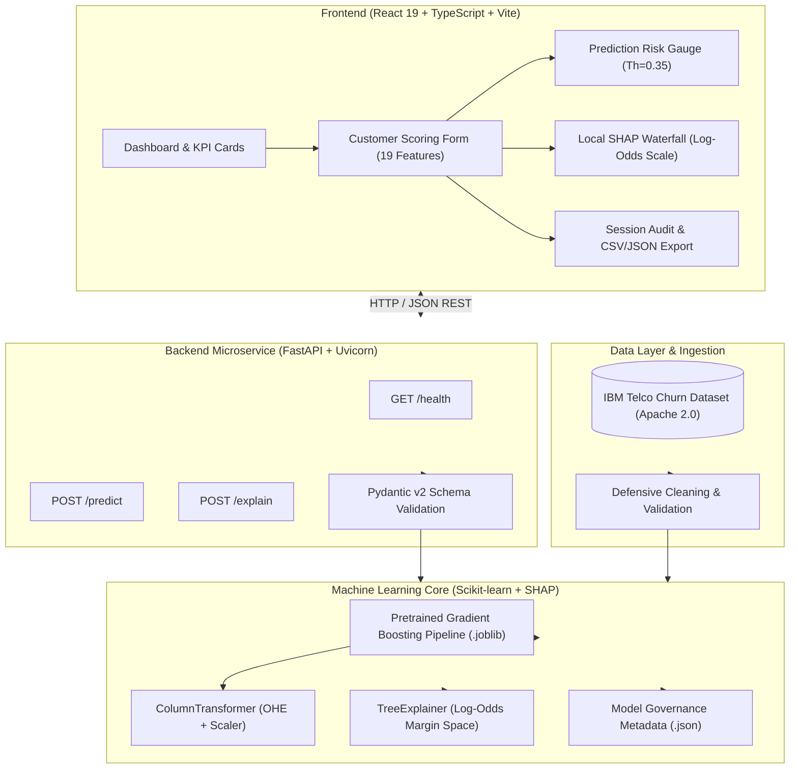

# 👁️ ChurnSight — See risk. Understand why.

[](https://www.python.org/downloads/)
[](https://react.dev/)
[](https://fastapi.tiangolo.com/)
[](https://opensource.org/licenses/Apache-2.0)
[-brightgreen.svg)](#-automated-testing)
[-blueviolet.svg)](#-model-benchmarking--rigorous-evaluation)

**ChurnSight** is an end-to-end Machine Learning and Full-Stack Customer Intelligence platform designed to predict customer churn risk, explain individual predictions using Explainable AI (SHAP), and empower retention teams to take targeted, data-backed proactive actions.

> **Note on Project Scope:** This is a portfolio demonstration project built with production-grade engineering principles and trained on the industry-standard IBM Telco Customer Churn dataset. It demonstrates how to properly design, benchmark, serve, and explain machine learning models—it is not currently deployed to production or claiming enterprise validation.

---

## 🌟 Main Capabilities

1. **Leak-Free Machine Learning Pipeline:** Defensive preprocessing using `ColumnTransformer` with `OneHotEncoder(handle_unknown='ignore')` and `StandardScaler`, fitted strictly within cross-validation folds.
2. **Methodological Model Selection:** Candidate benchmark comparing 5 model families (Logistic Regression, Random Forest, Gradient Boosting, HistGradientBoosting, Dummy Baseline) using 5-Fold Stratified Cross-Validation on training data alone.
3. **Out-of-Fold (OOF) Decision Threshold Optimization:** Selection of an operational decision cutoff ($P \ge 0.35$) based strictly on training out-of-fold predictions to maximize recall on churning accounts without peeking at the holdout set.
4. **Independent Fresh Holdout Evaluation:** Unbiased holdout assessment ($N = 1,409$) evaluated once on the frozen champion model.
5. **FastAPI Inference Microservice:** Production-minded REST API offering sub-millisecond predictions, Pydantic v2 input validation, CORS protection, and health monitoring.
6. **Local Explainable AI (SHAP TreeExplainer):** Real-time decomposition of individual customer predictions into signed log-odds contributions with mathematical additivity guarantees.
7. **Interactive React + TypeScript Dashboard:** Light enterprise SaaS analytics interface featuring customer scoring, operational threshold meters, local waterfall charts, and session history export.

---

## 🏗️ Architecture



---

## 💻 Technology Stack

| Layer | Technology | Primary Purpose |
|---|---|---|
| **Core ML** | Python 3.10+, Scikit-learn 1.4, NumPy, Pandas | Leak-free data transformations, cross-validation, and pipeline training |
| **Explainability (XAI)** | SHAP 0.49 (`TreeExplainer`) | Local and global attribution on the log-odds margin scale |
| **Backend API** | FastAPI 0.115, Uvicorn, Pydantic v2 | High-performance asynchronous inference, schema validation, and health checks |
| **Frontend UI** | React 19, TypeScript 5.8, Vite 8, Lucide React | Single-page customer retention and model inspection dashboard |
| **Styling** | Custom Vanilla CSS Design System | Clean enterprise SaaS light theme (Charcoal `#111827` + Emerald `#10B981`) |
| **Testing** | Pytest 9, Vitest 5, Testing Library | 82 Python unit/integration tests and 9 TypeScript UI tests |

---

## 📊 Dataset Provenance & Attribution

The platform uses the benchmark Telco Customer Churn dataset:
- **Provider:** IBM Developer / IBM Watson Analytics
- **Upstream Repository:** [IBM/telco-customer-churn-on-icp4d](https://github.com/IBM/telco-customer-churn-on-icp4d)
- **License:** **Apache License 2.0** (Open for research, educational, and commercial development)
- **Dimensions:** 7,043 customer accounts across 19 predictor features (demographics, services, contract terms, charges)
- **Target Distribution:** 5,174 retained accounts (73.5%) vs 1,869 churned accounts (26.5%)
- **Data Governance:** Dataset downloading is fully automated via `scripts/download_data.py`. Raw and cleaned CSV files are excluded from Git by default.

---

## 🏆 Model Benchmarking & Rigorous Evaluation

### Data Splitting & Governance Standard
1. **Partitioning:** Split into an 80% Development set ($N = 5,634$) and a 20% Fresh Holdout ($N = 1,409$, `holdout_seed = 100`).
2. **Champion Selection:** Evaluated 5 candidate pipelines using **5-Fold Stratified Cross-Validation strictly on the Development set** (`cv_seed = 42`). Champion chosen by mean CV PR-AUC.
3. **Threshold Optimization:** The operational threshold was optimized **strictly on Out-Of-Fold (OOF) cross-validation predictions** to maximize F1-score on the minority churn class.
4. **Final Holdout Isolation:** The frozen Gradient Boosting pipeline and frozen threshold were evaluated **once on the untouched Fresh Holdout**.

### 5-Fold Stratified Cross-Validation Benchmark (Development Set: $N = 5,634$)

| Model Pipeline | CV PR-AUC Mean | CV ROC-AUC Mean | CV F1 Mean | CV Recall Mean | CV Precision Mean | Status |
|---|---|---|---|---|---|---|
| **Gradient Boosting** | **0.6721 ± 0.0180** | **0.8484 ± 0.0060** | 0.5829 | 0.5211 | 0.6630 | 🏆 **Champion** |
| **Hist Gradient Boosting** | 0.6661 ± 0.0168 | 0.8443 ± 0.0057 | 0.5813 | 0.5224 | 0.6565 | Contender |
| **Random Forest** | 0.6632 ± 0.0181 | 0.8482 ± 0.0085 | 0.5745 | 0.4997 | **0.6768** | Contender |
| **Logistic Regression** | 0.6611 ± 0.0177 | 0.8473 ± 0.0098 | 0.6027 | 0.5538 | 0.6613 | Baseline |
| **Dummy Baseline** | 0.2654 ± 0.0001 | 0.5000 ± 0.0000 | 0.0000 | 0.0000 | 0.0000 | Sanity Floor |

---

### Operational Decision Threshold: Why $P \ge 0.35$?

Standard classification models default to an arbitrary 0.50 probability cutoff. In subscription churn prevention, **a false negative (failing to identify an exiting customer) is far more expensive than a false positive (proactively offering a discount or outreach to a customer who would have stayed)**.

By tuning the cutoff across Out-of-Fold training predictions, **$P \ge 0.35$** was selected:
- **Captures 71.39% of all churning accounts** in holdout testing (compared to only 54.28% at standard 0.50 cutoff).
- **Preserves a 55.97% precision**, preventing alert fatigue.

### Independent Final Evaluation: Fresh Holdout ($N = 1,409$)

Evaluated once after freezing the champion model and operational threshold:

| Evaluation Metric | Gradient Boosting (Th=0.35 Operational) | Gradient Boosting (Th=0.50 Standard) |
|---|---|---|
| **ROC-AUC** | **0.8413** | **0.8413** |
| **PR-AUC (Average Precision)** | **0.6447** | **0.6447** |
| **Recall (Sensitivity)** | **0.7139 (71.39%)** | 0.5428 (54.28%) |
| **Precision** | **0.5597 (55.97%)** | 0.6444 (64.44%) |
| **F1-Score** | **0.6275** | 0.5893 |
| **Overall Accuracy** | 77.50% | 79.91% |

#### Holdout Confusion Matrix ($P \ge 0.35$):
```text
                  Predicted Retained (0)   Predicted Churn (1)
Actual Retained (0)       825 (TN)                210 (FP)
Actual Churn (1)          107 (FN)                267 (TP)
```
- **Missed Churners (FN):** Reduced from 171 to 107.
- **Caught Churners (TP):** 267 out of 374 at-risk subscribers detected.

---

## 🔍 Understanding SHAP Explanations in Log-Odds Space

A common misconception in applied Machine Learning is treating SHAP values as direct percentage-point probability increments.

In **ChurnSight**, SHAP values for Gradient Boosting trees are computed in **raw model margin / log-odds space**:

$$F(x) = \ln\left(\frac{p}{1 - p}\right) = E[F(X)] + \sum_{i=1}^{M} \phi_i(x)$$

Where:
- $E[F(X)] \approx -1.5893$ is the baseline expected model output across the training distribution.
- $\phi_i(x)$ is the signed local contribution of feature $i$ in log-odds.
- $F(x)$ is the final model score margin, which maps monotonically to probability via the logistic sigmoid function: $p = \frac{1}{1 + e^{-F(x)}}$.

### Governance & Additivity Guarantee
- **Mathematical Additivity:** Every call to `POST /explain` verifies that $|F(x) - (E[F(X)] + \sum \phi_i)| < 10^{-4}$ (machine-precision verified).
- **Non-Causal Interpretation:** Feature attributions represent observational correlations in historical data, not guaranteed causal intervention levers.

---

## 🚀 Installation & Local Execution

### 1. Clone the Repository
```bash
git clone https://github.com/<your-username>/churnsight.git
cd churnsight
```

### 2. Environment Setup (Python 3.10+)
```bash
python -m venv .venv
# On Windows:
.\.venv\Scripts\Activate.ps1
# On Linux/macOS:
source .venv/bin/activate

pip install -r requirements.txt
```

### 3. Verify Local Setup & Data Pipeline
```bash
# Verify environment and dependencies
python scripts/verify_environment.py

# Download raw dataset and execute cleaning pipeline
python scripts/download_data.py
python scripts/run_data_pipeline.py
```

### 4. Start the FastAPI Backend
```bash
uvicorn src.api.main:app --host 127.0.0.1 --port 8000 --reload
```
- **Service Root:** `http://127.0.0.1:8000/`
- **Health Check:** `http://127.0.0.1:8000/health`
- **Interactive Swagger UI:** `http://127.0.0.1:8000/docs`
- **ReDoc Specification:** `http://127.0.0.1:8000/redoc`

### 5. Start the React Frontend Dashboard
In a separate terminal:
```bash
cd frontend
npm install
npm run dev
```
Open **`http://localhost:5173/`** in your browser.

---

## 🧪 Automated Testing

The project maintains **91 automated tests** covering data loaders, sanitizers, feature transformers, holdout isolation, FastAPI endpoints, and React components:

### Run Backend Pytest Suite (82 tests)
```bash
pytest
```
```text
============================= 82 passed in 7.78s =============================
```

### Run Frontend Vitest Suite (9 tests)
```bash
cd frontend
npm test
```
```text
 ✓ src/test/app.test.tsx (9 tests)
 Test Files  1 passed (1)
 Tests       9 passed (9)
```

---

## 🌐 Cloud Deployment Guide

ChurnSight is pre-configured for cloud deployment with the FastAPI backend on **Render** and the React frontend on **Vercel**.

### Backend Service (Render)
1. Create a new **Web Service** connected to the repository.
2. Configure the build and runtime settings:
   - **Environment:** `Python 3` (aligned with `.python-version`: `3.10.14`)
   - **Build Command:** `pip install -r requirements.txt`
   - **Start Command:** `uvicorn src.api.main:app --host 0.0.0.0 --port $PORT`
3. Configure Environment Variables:
   - `CORS_ORIGINS`: Must contain the exact deployed frontend origin (e.g. `https://churnsight.vercel.app`).

### Frontend Dashboard (Vercel)
1. Import the repository into Vercel.
2. In Project Settings, configure the framework and directories:
   - **Framework Preset:** `Vite`
   - **Root Directory:** `frontend`
   - **Build Command:** `npm run build`
   - **Output Directory:** `dist`
3. Configure Environment Variables:
   - `VITE_API_BASE_URL`: Must be configured to the deployed backend URL without a trailing slash (e.g. `https://churnsight-api.onrender.com`).

---

## 📁 Repository Directory Structure

```text
customer_churn_intelligence/
├── .gitignore                           # Git ignore rules for venv, data dumps, and caches
├── .python-version                      # Pinned Python 3.10.14 runtime for deployment
├── .env.example                         # Safe configuration template
├── pytest.ini                           # Pytest configuration & warning filters
├── requirements.txt                     # Pinned core Python dependencies
├── README.md                            # Main project documentation
│
├── data/
│   ├── raw/                             # Raw CSV dataset (ignored; reproducible via scripts/)
│   └── processed/                       # Cleaned CSV dataset (ignored; reproducible via scripts/)
│
├── models/
│   ├── churn_model.joblib               # Serialized Gradient Boosting Champion Pipeline (143 KB)
│   └── model_metadata.json              # Model benchmarks, seeds, and OOF threshold curves
│
├── notebooks/
│   └── 01_exploratory_data_analysis.ipynb # Executable EDA notebook (cleared of local machine paths)
│
├── reports/
│   └── shap/                            # Global beeswarm/bar plots & local case waterfall figures
│
├── scripts/
│   ├── download_data.py                 # Automated dataset downloader
│   ├── run_data_pipeline.py             # Single-command data ingestion and cleaning CLI
│   ├── train_and_benchmark.py           # CV model selection and holdout evaluation CLI
│   ├── generate_eda_notebook.py         # Programmatically compiles EDA notebook
│   ├── explain_customer.py              # CLI tool for local customer SHAP explanations
│   └── generate_shap_explanations.py    # Generates visual SHAP summary artifacts
│
├── src/
│   ├── data/                            # Defensive data loading, validation & cleaning
│   ├── features/                        # Leak-free ColumnTransformer preprocessing
│   ├── models/                          # Pipeline factory, CV benchmarking, threshold tuning
│   ├── explainability/                  # SHAP TreeExplainer & margin-space formatters
│   └── api/                             # FastAPI microservice (routes, schemas, service)
│
├── tests/                               # 82 automated backend test suites
│   ├── test_data_loader.py
│   ├── test_data_validator.py
│   ├── test_data_cleaner.py
│   ├── test_features.py
│   ├── test_models.py
│   ├── test_pipeline.py
│   ├── test_api.py
│   └── test_explainability.py
│
└── frontend/                            # React 19 + TypeScript + Vite UI
    ├── package.json
    ├── vite.config.ts
    ├── index.html
    ├── README.md                        # Frontend-specific architecture documentation
    └── src/
        ├── App.tsx                      # View orchestration
        ├── index.css                    # Vanilla CSS design tokens (Charcoal + Emerald)
        ├── api/client.ts                # Typed HTTP API client
        ├── components/                  # CustomerForm, PredictionCard, ShapWaterfall, BrandWordmark
        ├── context/                     # Session state & scoring history
        └── pages/                       # Dashboard, Analysis, Predictions, Insights, Reports, Settings
```

---

## ⚠️ Limitations & Future Work

- **Batch Inference Endpoint:** Current backend focuses on real-time single-customer scoring (`/predict` and `/explain`). Future iterations could add asynchronous batch processing via message queues (e.g. Celery / Redis).
- **Persistent Storage:** Customer analyses are currently recorded in the active browser session. Production deployments would connect to a persistent customer data warehouse (e.g. PostgreSQL / BigQuery).
- **Model Monitoring & Drift Detection:** Real-world deployments require tracking population covariate drift (e.g. via Evidently or Great Expectations) as customer usage habits evolve.
- **Intervention Tracking:** Future work should log whether recommended customer retention actions resulted in successful contract renewal to enable uplift modeling.

---

## 📜 License & Attribution

- **Dataset:** IBM Telco Customer Churn dataset licensed under **Apache 2.0**.
- **Software Code:** Open-source under MIT or Apache 2.0 for portfolio, educational, and developer evaluation.
