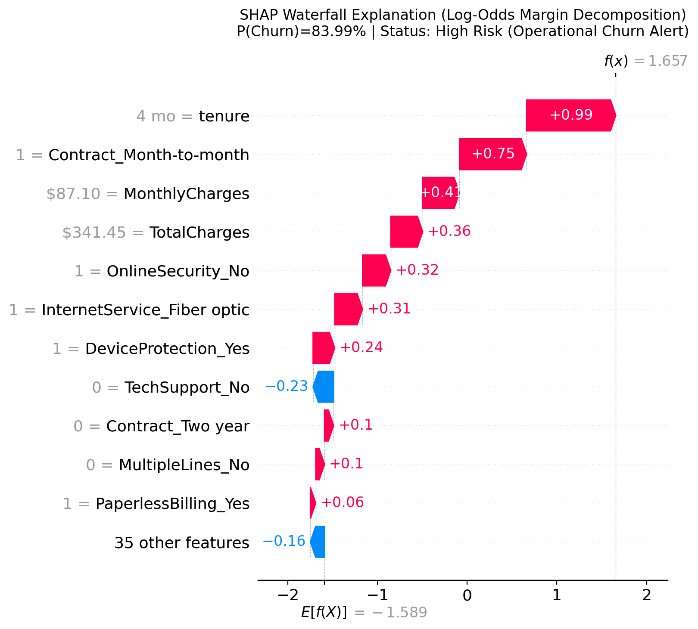

# Local Customer Churn Explanation Report

**Analysis Case:** `case_1_high_risk` 
**Risk Classification:** **High Risk (Operational Churn Alert)** 
**Predicted Churn Probability:** **83.99%** 
**Operational Decision Threshold:** `0.35` (Actionable Churn Alert if >= 0.35) 
**Standard Threshold Comparison:** `0.50` (Prediction: `1`)

---

## 1. Executive Summary & Scoring Metrics

| Metric | Value | Interpretation |
| :--- | :--- | :--- |
| **Model Churn Probability** | **0.8399** (83.99%) | Calibrated logistic probability sigmoid(F(x)) |
| **Operational Risk Alert** | **High Risk (Operational Churn Alert)** | Flagged using frozen operational threshold 0.35 |
| **Standard Baseline Probability** | **0.1695** (16.95%) | Population prior expectation before individual features |
| **Baseline Log-Odds (F0)** | **-1.5893** | Logit intercept across development training distribution |
| **Final Model Score (F(x))** | **+1.6575** | Log-odds margin: F0 + sum(phi_i) |
| **Sum of SHAP Values (sum phi_i)** | **+3.2467** | Net shift in log-odds produced by customer features |
| **Additivity Discrepancy** | **6.66e-16** | Exact machine precision match with `decision_function` |

---

## 2. Top Risk Factors Pushing Toward Churn (phi_i > 0)

The following features exerted the strongest mathematical push **increasing** the churn log-odds for this customer:

| Observed Feature & Status | Encoded Feature Column | SHAP Impact (Log-Odds) | Detailed Explanation |
| :--- | :--- | :--- | :--- |
| `Customer Tenure (4 mo)             ` | `tenure                        ` | +0.9944    | Observed customer tenure of 4 month(s) contributes +0.9944 log-odds, pushing the model output toward churn by +0.9944 log-odds for this prediction. |
| `Contract = 'Month-to-month'        ` | `Contract_Month-to-month       ` | +0.7487    | Contract is 'Month-to-month' (indicator active), contributing +0.7487 log-odds, pushing the model output toward churn by +0.7487 log-odds for this prediction. |
| `Monthly Charges ($87.10)           ` | `MonthlyCharges                ` | +0.4090    | Observed monthly bill of $87.10 contributes +0.4090 log-odds, pushing the model output toward churn by +0.4090 log-odds for this prediction. |
| `Total Charges ($341.45)            ` | `TotalCharges                  ` | +0.3566    | Observed total cumulative spend of $341.45 contributes +0.3566 log-odds, pushing the model output toward churn by +0.3566 log-odds for this prediction. |
| `Online Security = 'No'             ` | `OnlineSecurity_No             ` | +0.3150    | Online Security is 'No' (indicator active), contributing +0.3150 log-odds, pushing the model output toward churn by +0.3150 log-odds for this prediction. |

---

## 3. Top Factors Suppressing Churn Risk (phi_i < 0)

The following features exerted the strongest mathematical push **decreasing** the churn log-odds for this customer:

| Observed Feature & Status | Encoded Feature Column | SHAP Impact (Log-Odds) | Detailed Explanation |
| :--- | :--- | :--- | :--- |
| `Tech Support != 'No' (Actual: 'Yes')` | `TechSupport_No                ` | -0.2300    | Tech Support is not 'No' (observed: 'Yes', indicator inactive), contributing -0.2300 log-odds, pushing the model output away from churn by -0.2300 log-odds for this prediction. |
| `Payment Method != 'Electronic check' (Actual: 'Mailed check')` | `PaymentMethod_Electronic check` | -0.0532    | Payment Method is not 'Electronic check' (observed: 'Mailed check', indicator inactive), contributing -0.0532 log-odds, pushing the model output away from churn by -0.0532 log-odds for this prediction. |
| `Streaming Movies != 'Yes' (Actual: 'No')` | `StreamingMovies_Yes           ` | -0.0470    | Streaming Movies is not 'Yes' (observed: 'No', indicator inactive), contributing -0.0470 log-odds, pushing the model output away from churn by -0.0470 log-odds for this prediction. |
| `Dependents = 'Yes'                 ` | `Dependents_Yes                ` | -0.0378    | Dependents is 'Yes' (indicator active), contributing -0.0378 log-odds, pushing the model output away from churn by -0.0378 log-odds for this prediction. |
| `Tech Support = 'Yes'               ` | `TechSupport_Yes               ` | -0.0235    | Tech Support is 'Yes' (indicator active), contributing -0.0235 log-odds, pushing the model output away from churn by -0.0235 log-odds for this prediction. |

---

## 4. Key Customer Profile Attributes

- **Contract Commitment:** `Month-to-month`
- **Customer Tenure:** `4 months`
- **Monthly Recurring Charges:** `$87.10`
- **Total Charges to Date:** `$341.45`
- **Internet Service:** `Fiber optic`
- **Tech Support:** `Yes`
- **Online Security:** `No`
- **Payment Method:** `Mailed check`

---

## 5. Governance and Methodology Notice

> [!WARNING]
> **Descriptive Model Behavior vs. Causal Truth:** Governance Notice: These local SHAP contributions quantify the mathematical influence of each feature on the model's log-odds output margin F(x). They explain predictive model behavior in observational data, not confirmed causal drivers or guaranteed retention outcomes. Do not interpret feature correlations as causal levers without business domain validation.

- **Scale Integrity:** SHAP values are strictly calculated and summed on the **log-odds margin scale**. They are not additive percentages and must not be added directly to probabilities.
- **Holdout Isolation Guarantee:** This customer profile was drawn exclusively from the Development partition. No final holdout evaluation data was examined or utilized.
