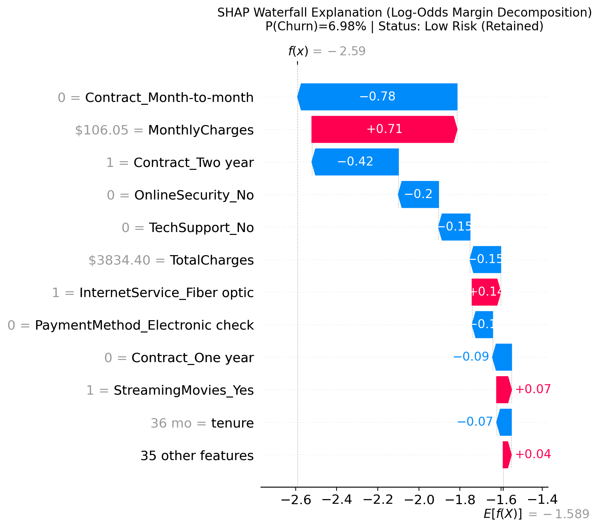

# Local Customer Churn Explanation Report

**Analysis Case:** `case_3_low_risk` 
**Risk Classification:** **Low Risk (Retained)** 
**Predicted Churn Probability:** **6.98%** 
**Operational Decision Threshold:** `0.35` (Actionable Churn Alert if >= 0.35) 
**Standard Threshold Comparison:** `0.50` (Prediction: `0`)

---

## 1. Executive Summary & Scoring Metrics

| Metric | Value | Interpretation |
| :--- | :--- | :--- |
| **Model Churn Probability** | **0.0698** (6.98%) | Calibrated logistic probability sigmoid(F(x)) |
| **Operational Risk Alert** | **Low Risk (Retained)** | Flagged using frozen operational threshold 0.35 |
| **Standard Baseline Probability** | **0.1695** (16.95%) | Population prior expectation before individual features |
| **Baseline Log-Odds (F0)** | **-1.5893** | Logit intercept across development training distribution |
| **Final Model Score (F(x))** | **-2.5903** | Log-odds margin: F0 + sum(phi_i) |
| **Sum of SHAP Values (sum phi_i)** | **-1.0010** | Net shift in log-odds produced by customer features |
| **Additivity Discrepancy** | **1.78e-15** | Exact machine precision match with `decision_function` |

---

## 2. Top Risk Factors Pushing Toward Churn (phi_i > 0)

The following features exerted the strongest mathematical push **increasing** the churn log-odds for this customer:

| Observed Feature & Status | Encoded Feature Column | SHAP Impact (Log-Odds) | Detailed Explanation |
| :--- | :--- | :--- | :--- |
| `Monthly Charges ($106.05)          ` | `MonthlyCharges                ` | +0.7062    | Observed monthly bill of $106.05 contributes +0.7062 log-odds, pushing the model output toward churn by +0.7062 log-odds for this prediction. |
| `Internet Service = 'Fiber optic'   ` | `InternetService_Fiber optic   ` | +0.1385    | Internet Service is 'Fiber optic' (indicator active), contributing +0.1385 log-odds, pushing the model output toward churn by +0.1385 log-odds for this prediction. |
| `Streaming Movies = 'Yes'           ` | `StreamingMovies_Yes           ` | +0.0721    | Streaming Movies is 'Yes' (indicator active), contributing +0.0721 log-odds, pushing the model output toward churn by +0.0721 log-odds for this prediction. |
| `Paperless Billing = 'Yes'          ` | `PaperlessBilling_Yes          ` | +0.0467    | Paperless Billing is 'Yes' (indicator active), contributing +0.0467 log-odds, pushing the model output toward churn by +0.0467 log-odds for this prediction. |
| `Paperless Billing != 'No' (Actual: 'Yes')` | `PaperlessBilling_No           ` | +0.0335    | Paperless Billing is not 'No' (observed: 'Yes', indicator inactive), contributing +0.0335 log-odds, pushing the model output toward churn by +0.0335 log-odds for this prediction. |

---

## 3. Top Factors Suppressing Churn Risk (phi_i < 0)

The following features exerted the strongest mathematical push **decreasing** the churn log-odds for this customer:

| Observed Feature & Status | Encoded Feature Column | SHAP Impact (Log-Odds) | Detailed Explanation |
| :--- | :--- | :--- | :--- |
| `Contract != 'Month-to-month' (Actual: 'Two year')` | `Contract_Month-to-month       ` | -0.7759    | Contract is not 'Month-to-month' (observed: 'Two year', indicator inactive), contributing -0.7759 log-odds, pushing the model output away from churn by -0.7759 log-odds for this prediction. |
| `Contract = 'Two year'              ` | `Contract_Two year             ` | -0.4205    | Contract is 'Two year' (indicator active), contributing -0.4205 log-odds, pushing the model output away from churn by -0.4205 log-odds for this prediction. |
| `Online Security != 'No' (Actual: 'Yes')` | `OnlineSecurity_No             ` | -0.1956    | Online Security is not 'No' (observed: 'Yes', indicator inactive), contributing -0.1956 log-odds, pushing the model output away from churn by -0.1956 log-odds for this prediction. |
| `Tech Support != 'No' (Actual: 'Yes')` | `TechSupport_No                ` | -0.1531    | Tech Support is not 'No' (observed: 'Yes', indicator inactive), contributing -0.1531 log-odds, pushing the model output away from churn by -0.1531 log-odds for this prediction. |
| `Total Charges ($3834.40)           ` | `TotalCharges                  ` | -0.1494    | Observed total cumulative spend of $3834.40 contributes -0.1494 log-odds, pushing the model output away from churn by -0.1494 log-odds for this prediction. |

---

## 4. Key Customer Profile Attributes

- **Contract Commitment:** `Two year`
- **Customer Tenure:** `36 months`
- **Monthly Recurring Charges:** `$106.05`
- **Total Charges to Date:** `$3834.40`
- **Internet Service:** `Fiber optic`
- **Tech Support:** `Yes`
- **Online Security:** `Yes`
- **Payment Method:** `Credit card (automatic)`

---

## 5. Governance and Methodology Notice

> [!WARNING]
> **Descriptive Model Behavior vs. Causal Truth:** Governance Notice: These local SHAP contributions quantify the mathematical influence of each feature on the model's log-odds output margin F(x). They explain predictive model behavior in observational data, not confirmed causal drivers or guaranteed retention outcomes. Do not interpret feature correlations as causal levers without business domain validation.

- **Scale Integrity:** SHAP values are strictly calculated and summed on the **log-odds margin scale**. They are not additive percentages and must not be added directly to probabilities.
- **Holdout Isolation Guarantee:** This customer profile was drawn exclusively from the Development partition. No final holdout evaluation data was examined or utilized.
